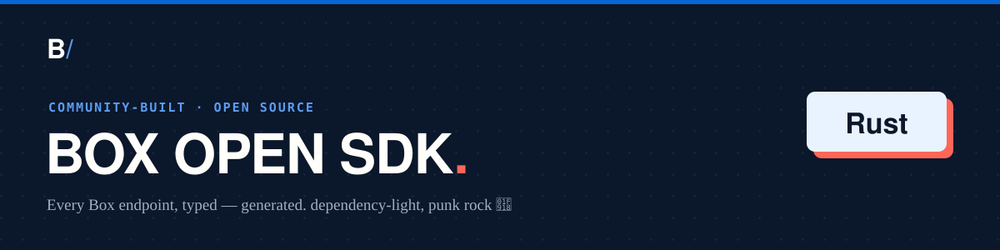

<!-- Generated by box-gantry. DO NOT EDIT — regenerate from the specs instead. -->


# box-open-sdk (Rust)

[](https://github.com/unofficialbox/box-open-rust-sdk/releases/latest)
[](https://crates.io/crates/box-open-sdk)
[](https://docs.rs/box-open-sdk)
[](LICENSE)

An **open source, community-built** Box API client for Rust — typed models for the whole
Box surface, one async manager per API area behind a single `Client`, and a
`reqwest`/`tokio` runtime with retry, exponential backoff, `Retry-After`
handling, and automatic token refresh.

> **Not affiliated with, authorized, or endorsed by Box, Inc.** "Box" is a
> trademark of Box, Inc. This is an independent, generated client.

## Install

```toml
[dependencies]
box-open-sdk = "0.8"
tokio = { version = "1", features = ["full"] }
```

## Quickstart

Authenticate, look up the current user, create a folder, upload a file, extract
its fields with Box AI, tag it with metadata, and query for it — end to end.
Request bodies derive `Default`, so only the fields you set are named:

```rust,ignore
use box_open_sdk::auth::{Auth, CcgConfig};
use box_open_sdk::client::Client;
use box_open_sdk::models::schemas;

#[tokio::main]
async fn main() -> Result<(), Box<dyn std::error::Error>> {
    // Client Credentials Grant (server-to-server); developer token, OAuth, and
    // JWT also live in `box_open_sdk::auth`.
    let client = Client::new(Auth::client_credentials(CcgConfig {
        client_id: "CLIENT_ID".into(),
        client_secret: "CLIENT_SECRET".into(),
        enterprise_id: "ENTERPRISE_ID".into(),
        ..Default::default()
    }));

    // The current user.
    let me = client.users.get_me(None).await?;
    println!("authenticated as {}", me.id);

    // Create a folder at the account root ("0").
    let folder = client
        .folders
        .create(
            schemas::CreateFolderRequest {
                name: "Invoices".into(),
                parent: schemas::AttributesParent { id: "0".into() },
                ..Default::default()
            },
            None,
        )
        .await?;

    // Upload a file into it.
    let uploaded = client
        .uploads
        .upload_file(
            schemas::CreateFileContentRequest {
                attributes: schemas::PostFileContentAttributes {
                    name: "invoice.pdf".into(),
                    parent: schemas::AttributesParent { id: folder.id.clone() },
                    ..Default::default()
                },
                file: b"<file bytes>".to_vec(),
            },
            None,
        )
        .await?;
    let file_id = uploaded.entries.unwrap_or_default().remove(0).id;

    // Extract fields from the file with Box AI.
    let answer = client
        .ai
        .extract(schemas::AiExtract {
            prompt: "Extract the invoice number and total amount.".into(),
            items: vec![schemas::AiItemBase {
                id: file_id.clone(),
                r#type: schemas::AiCitationType(schemas::AiCitationType::FILE.into()),
                ..Default::default()
            }],
            ..Default::default()
        })
        .await?;
    println!("{answer:?}");

    // Attach that metadata to the file (an enterprise template).
    client
        .file_metadata
        .create_file_metadata(
            file_id.clone(),
            schemas::GetFileIdMetadataIdScope(schemas::GetFileIdMetadataIdScope::ENTERPRISE.into()),
            "invoiceData".into(),
            std::collections::HashMap::from([
                ("invoiceNumber".to_string(), serde_json::json!("INV-0042")),
                ("total".to_string(), serde_json::json!(1250)),
            ]),
        )
        .await?;

    // Query for files carrying that metadata.
    let results = client
        .search
        .query_by_metadata(schemas::MetadataQuery {
            from: "enterprise_0.invoiceData".into(),
            ancestor_folder_id: folder.id.clone(),
            ..Default::default()
        })
        .await?;
    println!("{results:?}");

    Ok(())
}
```

## Authentication

Box's four auth flows all live in `box_open_sdk::auth` — **developer token**,
**client credentials (CCG)**, **OAuth 2.0** (with a pluggable refresh-token
store), and **JWT** (server auth). See [`docs/auth.md`](./docs/auth.md).

## Pagination

List endpoints return an auto-paging stream — advancing the cursor and fetching
the next page is handled for you. See [`docs/pagination.md`](./docs/pagination.md).

## HTTP versions

API requests negotiate HTTP/2 over TLS and fall back to HTTP/1.1. Configure the
runtime session — HTTP version, retries, default headers, or your own
`reqwest::Client` — and build the client from it:

```rust,ignore
use box_open_sdk::client::Client;
use box_open_sdk::runtime::{self, HttpVersion};

let session = runtime::Client::new(auth).with_http_version(HttpVersion::Http1);
let client = Client::from_session(session);
```

`with_http_version` and `with_http_client` replace each other — the last one
wins. HTTP/3 is not offered yet (reqwest's support is unstable). Token requests
keep their own client.

## Documentation

API reference on [docs.rs](https://docs.rs/box-open-sdk); the [`docs/`](./docs)
tree carries the per-manager reference — a call snippet for every method — and
the authentication, pagination, and errors guides.

## License

MIT. Generated by [box-gantry](https://github.com/unofficialbox/box-gantry).
